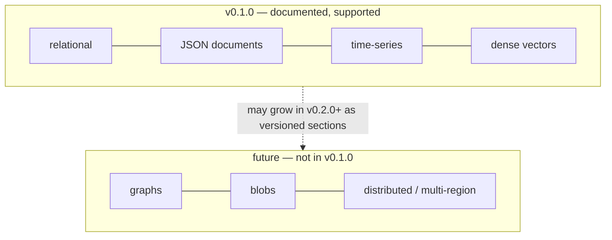

# Roadmap — beyond v0.1.0

<Warning>
  **Roadmap firewall:** a mention here is not a promise of syntax, timeline, or compatibility. This page exists so nobody mistakes a plan for a feature. Do not build on it.
</Warning>



## Correction: vectors ARE in v0.1.0

An earlier version of this page stated vector types do not exist. That was wrong: dense `VECTOR` columns, distance operators (`<->`, `<=>`, `<#>`, `<~>`, `<%>`), exact top-k, HNSW indexes, and metadata-filtered search are **supported** and verified. The full section lives at [Vector search](/v0.1.0/vector/overview) — start with [Vector quickstart](/v0.1.0/vector/quickstart). Sparse, multivector, and GPU paths remain experimental or unsupported per [Vector limitations](/v0.1.0/vector/limitations).

## GRAPH (not available)

| Question | Answer |
| --- | --- |
| Node/edge tables, `MATCH`, traversals? | No. No graph DDL, no path queries, no traversal executor. |
| What you CAN do today | Model adjacency relationally (`edges(src, dst)` + recursive CTEs for bounded hops). |

```sql
-- TODAY: bounded hops with RECURSIVE (relational, unindexed-traversal):
WITH RECURSIVE hops(n, d) AS (
  SELECT 1, 0 UNION SELECT e.dst, h.d+1 FROM edges e JOIN hops h ON e.src = h.n WHERE h.d < 3
) SELECT * FROM hops;
```

## BLOBS / multi-region / distributed

Also not in v0.1.0: no blob type, no replication, no multi-region, no distributed deployment, no managed cloud. Single-node server + WAL + checkpoints + cold backup only.

**When these land:** they will appear as versioned sections (`v0.2.0/...`) with ADDED/CHANGED tables. v0.1.0 pages will not be rewritten to pretend otherwise.
