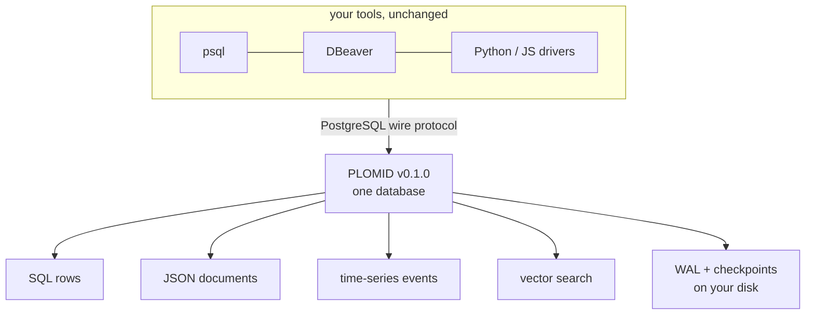

# PLOMID v0.1.0

PLOMID is a single-node database for rows, JSON documents, time-ordered events, and embedding vectors — one SQL interface over the PostgreSQL wire protocol your tools already speak. This documentation describes `v0.1.0` **beta**: verified behavior, stated limits, and nothing else.

<Warning>
  **Beta.** v0.1.0 targets single-node, single-operator deployments. Database DDL is privilege-gated (superuser or `CREATEDB`), but `DROP DATABASE` is not owner-scoped, so any `CREATEDB` role can drop databases it did not create; shared multi-user deployments remain unsupported. Read [Beta status](/v0.1.0/getting-started/beta-status) before exposing a server to anyone else.
</Warning>

## Start here (learning path)

<Steps>
  <Step title="Install">
    Pick a verified method — native binaries, shell installer, Docker, source, or offline. [Choose an installation method](/v0.1.0/install/overview).
  </Step>
  <Step title="Quickstart">
    Start the server, connect, create a table, query it, prove persistence. [Quickstart](/v0.1.0/getting-started/quickstart).
  </Step>
  <Step title="Connect your app">
    `psql`, Python, or JavaScript with parameters and pooling. [Connect](/v0.1.0/connect/overview).
  </Step>
  <Step title="Build">
    Task guides: JSON, time-series, transactions, indexes, semantic retrieval, backup. [Guides](/v0.1.0/cookbook/overview).
  </Step>
  <Step title="Go deeper">
    SQL reference, vector search, operations, and the honest [Support matrix](/v0.1.0/reference/support-matrix).
  </Step>
</Steps>

## What v0.1.0 supports

| Area | Status | Start here |
| --- | --- | --- |
| SQL DDL/DML, joins, CTEs, window functions | **Supported** | [SQL overview](/v0.1.0/sql/overview) |
| JSON/JSONB operators and functions | **Supported** | [JSON](/v0.1.0/json/overview) |
| Temporal types and time-series queries | **Supported** | [Time-series](/v0.1.0/timeseries/overview) |
| Dense vector storage, distance operators, exact + HNSW search | **Supported** | [Vector search](/v0.1.0/vector/overview) |
| Transactions with MVCC snapshots | **Supported** | [Transactions](/v0.1.0/transactions/using-transactions) |
| WAL + checkpoints + crash recovery | **Supported** | [WAL / recovery](/v0.1.0/storage/wal-checkpoints-recovery) |
| Wire protocol v3 (SCRAM/MD5/cleartext), TLS transport | **Supported** | [Connect](/v0.1.0/connect/overview) |
| Cold backup → clean restore | **Supported** | [Backup and restore](/v0.1.0/operations/backup-restore) |
| Graph, blobs, distribution, replication | **Not in v0.1.0** | [Roadmap](/v0.1.0/future/vector-graph) |

Full record with every limitation: [Support matrix](/v0.1.0/reference/support-matrix) · [Beta status](/v0.1.0/getting-started/beta-status) · [SQL compatibility](/v0.1.0/sql/compatibility).

## Reference shortcuts

[SQL](/v0.1.0/sql/overview) · [Data types](/v0.1.0/data/types) · [Functions](/v0.1.0/reference/scalar-functions) · [Operators](/v0.1.0/sql/operators) · [Configuration](/v0.1.0/reference/config-reference) · [CLI](/v0.1.0/reference/cli-reference) · [Errors](/v0.1.0/reference/errors) · [Catalog](/v0.1.0/reference/pg-catalog)

## Operate it

[Run the server](/v0.1.0/operations/run-server) · [Configuration](/v0.1.0/operations/configuration) · [TLS](/v0.1.0/operations/tls) · [Backup and restore](/v0.1.0/operations/backup-restore) · [Troubleshooting](/v0.1.0/troubleshooting/overview)
