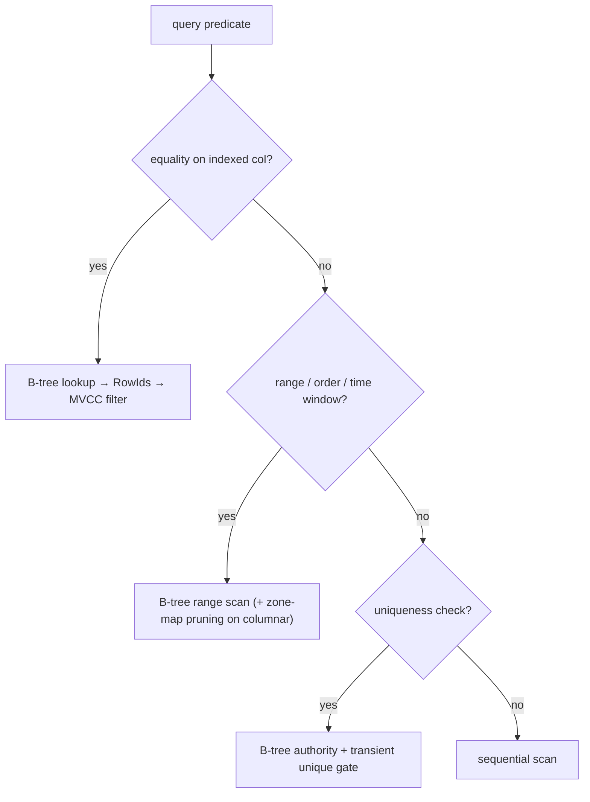

# Indexes



## Why

Tables are the authority; indexes are access paths for equality, range, ordering, time windows, and uniqueness. Without one, every predicate scans.

Unique and primary-key violations fail the statement with `duplicate key value violates unique index` (SQLSTATE `23505`) — pair with `ON CONFLICT DO NOTHING / DO UPDATE` for idempotent writes. B-trees are maintained on every write and verified on recovery, so they need no `REINDEX`. `REINDEX` is nevertheless real at the engine level: it drops every cached derived ANN graph (vector indexes rebuild lazily on the next eligible query) and revalidates vector index metadata; the run is recorded in `plomid_stat_admin()`.

## Practical

```sql
CREATE INDEX orders_user_idx ON orders (user_id);
CREATE UNIQUE INDEX users_email_uidx ON users (email);
CREATE INDEX events_ts_idx ON events (ts);
CREATE INDEX recent_big ON orders ((total)) WHERE total > 100;  -- NO: partial predicates unsupported; use plain index
```

Correct expression form:

```sql
CREATE INDEX events_team_idx ON events ((payload->>'team'));
```

## What each serves

- **B-tree (persistent)**: point equality, unique/PK enforcement, ordered range/prefix scans, min/max bounds. Survives restarts via WAL replay — the durable authority for uniqueness.
- **ART (in-memory)**: coordinates hot lookups during the session; the persistent B-tree remains the authority after restart.

## What they don't do

No full-text, no vector KNN, no partial/expression-multi-column magic beyond single-expression keys, no planner cost choice in v0.1.0.

## Internals (for contributors)

Index maintenance is transactional: entries appear at commit, disappear at rollback, and concurrent writers coordinate on unique keys. **Next:** [Create an index](/v0.1.0/build/create-index) · [Inspect a query](/v0.1.0/build/inspect-query)
