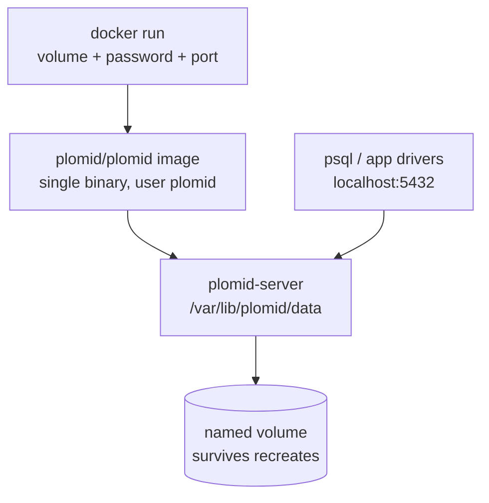

# Run PLOMID with Docker



**Status: Supported.** The runtime image is deliberately minimal: Debian slim plus the single compiled `plomid-server` binary, running as the unprivileged `plomid` user. No toolchain, no source, no package cache.

## Prerequisites

- Docker (BuildKit for multi-arch), the Linux server binary built via `make linux-binary` (or `make docker`, which builds it first).

## Build the image

```sh
make docker       # cross-builds the Linux binary, packages the runtime image
```

## Run it with persistent storage

```sh
docker run -d \
  --name plomid \
  -p 5432:5432 \
  -e PLOMID_PASSWORD="<secret>" \
  -v plomid-data:/var/lib/plomid/data \
  plomid/plomid:latest
```

Pin a version in production: `plomid/plomid:<VERSION>` (for example `v0.1.0-beta.1`). The `:latest` tag moves; image pushes from the release pipeline are best-effort, so confirm the tag exists before depending on it.

What each part does:

- `-v plomid-data:/var/lib/plomid/data` — the data directory. **Without a volume, your database disappears with the container.** Always mount one.
- `-e PLOMID_PASSWORD` — the password (never bake secrets into images; prefer Docker secrets or your orchestrator's secret store).
- `-p 5432:5432` — exposes the PostgreSQL wire port.
- A container is reachable only via a non-loopback bind, which the server refuses without secure configuration (fail-closed). The image does not bake in the plaintext opt-in: set a password and prefer TLS (see [TLS](/v0.1.0/operations/tls)), or add `--allow-remote-plaintext` only on a trusted network.

## Verify, logs, stop

```sh
psql "postgresql://plomid:<secret>@localhost:5432/plomid" -c "SELECT version();"
make docker-logs    # follow container logs
make docker-stop    # stop and remove the container (keeps the data volume)
```

Helper targets: `make docker-run PLOMID_PASSWORD=<secret>` starts the hardened local container on 5432; `make image-info` shows image size and contents.

## Update

```sh
# 1. Back up (cold backup of the volume contents) — see Backup and restore.
# 2. Stop: make docker-stop (or docker stop plomid && docker rm plomid).
# 3. Pull the new tag, start a container on the same volume, verify.
```

## Troubleshooting

| Symptom | Fix |
| --- | --- |
| Container exits: non-loopback bind refused | Set `PLOMID_PASSWORD` and TLS, or add the explicit plaintext opt-in on trusted networks only. |
| Data lost after recreate | You forgot the volume — recreate with `-v` and restore from backup. |
| Port conflict | Remap with `-p 5433:5432`. |

<Note>
  No `docker-compose.yml` ships with PLOMID. Community compose files may exist, but none is tested or supported — the `docker run` invocation above is the verified path.
</Note>

Next: [Quickstart](/v0.1.0/getting-started/quickstart) · [Configuration](/v0.1.0/reference/config-reference).
