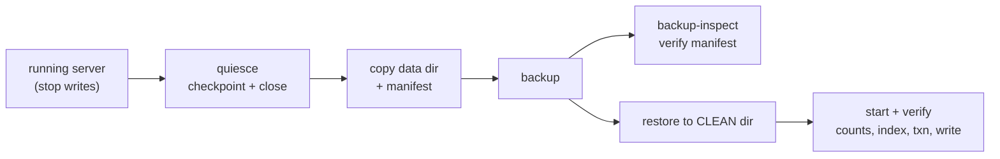

# Backup and restore



Cold full backup only: stop writes (checkpoint and close the engine, or stop the server), copy the data directory, restore to a **clean** directory. There is no hot backup, no incremental backup, and no point-in-time recovery in Beta 2.

## Backup

1. Checkpoint: ensure the engine checkpoints (graceful shutdown checkpoints automatically), then stop the server or close all writers.
2. Copy the entire data directory to the backup location. The copy must be taken while no writer is running. The `plomid-server backup` command performs the quiesce (open, checkpoint, close) and the copy in one fenced step — see below.
3. The backup ends with a manifest (`PLOMID_BACKUP_MANIFEST`). A backup without a manifest is an **interrupted backup** — discard it, never restore from it.

## Offline backup commands

The same binary ships fenced offline tools (they never start a listener). Each mutating command takes an advisory lock on its target directory and refuses to run against a live server instead of copying under a writer:

```bash
plomid-server backup --data /var/lib/plomid/data --to /backups/plomid-2026-10-14
plomid-server backup-inspect --backup /backups/plomid-2026-10-14
plomid-server restore --from /backups/plomid-2026-10-14 --to /var/lib/plomid/restored
```

`plomid-server help-backup` prints the same contract. Both `--flag value` and `--flag=value` forms work.

`backup` checkpoints and closes the engine before copying; `restore` additionally refuses non-clean destinations; `backup-inspect` is read-only and prints the manifest (format versions, file count, bytes, timestamp). Exit codes: `0` ok, `1` usage, `2` target live or refused, `3` operation failed (message on stderr in all cases).

Excluded by design: `*.tmp` staged files and the derived `vector_ann` cache (rebuilt from rows on reopen).

## Restore

1. Restore **to a clean (empty or nonexistent) directory only**. Restoring over a live database is refused — this is the rollback policy, not a limitation to work around.
2. Start the server against the restored directory. Recovery replays the WAL tail automatically; torn tails are truncated, corruption fails loud.
3. Verify: row counts and checksums (`COUNT(*)`, `SUM`), index lookups, one transaction (`BEGIN … COMMIT`), and one new write followed by a second reopen.

## Upgrade and rollback

- Upgrade: cold backup on the old binary → restore to a clean directory with the new binary → verify. A version-skewed image fails with `Unsupported` (never a silent downgrade) — upgrade the binary instead.
- Rollback: restore the pre-upgrade cold backup to a clean directory. There is no in-place downgrade path.

## Limits

- Full copies only; large databases need proportional disk and time.
- `COPY TO` output, audit logs, and TLS keys are not part of a database backup — back those up separately.
