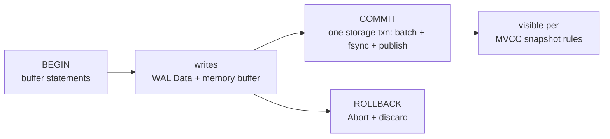

# Using transactions



See [Run transactions](/v0.1.0/build/run-transactions) for the task guide. This page is the precise reference.

```text
BEGIN [TRANSACTION|WORK] [ISOLATION LEVEL …|READ ONLY|…]
START TRANSACTION […] | SET [SESSION|LOCAL] TRANSACTION … | SET … CHARACTERISTICS …
COMMIT [opts] | ROLLBACK [TO [SAVEPOINT] name] [opts]
```

- `execute_all` splits batches depth-aware on `;`; `BEGIN` buffers into `pending`; `COMMIT|ROLLBACK` runs the group as one storage transaction.
- In-txn writes allowed: `INSERT/UPDATE/DELETE` + `CREATE TABLE|VIEW`. `COPY` and `UPDATE…FROM` in-txn → `Unsupported`.
- `SET search_path` in-batch affects later statements.
- `SET TRANSACTION ISOLATION LEVEL {READ COMMITTED | REPEATABLE READ}` and `SET SESSION CHARACTERISTICS` are accepted and stored as the session default; `SERIALIZABLE` is rejected, as is changing it mid-transaction or issuing `SET TRANSACTION` outside a transaction block.
- Idle transactions are reaped after `idle_in_transaction_session_timeout` (default 60s, `0` disables): the connection closes with `25P03` — commit or roll back promptly. See [Pooling and errors](/v0.1.0/connect/pooling-errors).

Isolation options parse but the engine is single-writer with MVCC snapshots (see [MVCC](/v0.1.0/transactions/mvcc)); there is no multi-writer serializable scheduler to tune in v0.1.0.
