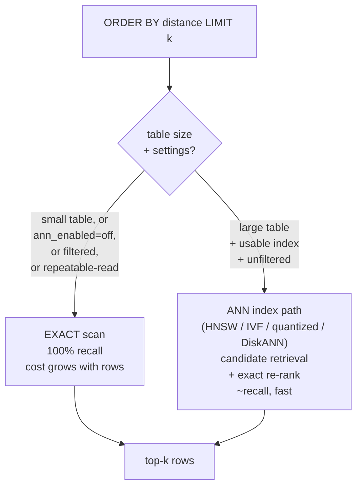

# Exact vs approximate search

## The trade-off

|  | Exact scan | Approximate (HNSW) |
| --- | --- | --- |
| Recall | 100% by construction | High but \< 100%; tunable via `ef_search` / oversampling |
| Latency | Grows linearly with rows | Grows slowly (graph traversal + re-rank) |
| Memory | No index structure | Graph + vectors resident (bounded by `vector.max_memory_bytes`) |
| Build cost | None | Paid at index build; rebuilt from rows after restore |
| Correctness risk | None | None for returned ordering — candidates are re-ranked with exact distances |

Only publish recall/latency numbers you measured yourself on your data, model dimension, and hardware. This documentation makes no performance claims — see [Performance](/v0.1.0/vector/performance).

## Measured dense quality (v0.1.0)

The hardest exercise in CI is the clustered dim-64 fixture from the ANN
quality investigation (8 centers, ±0.05 lane noise, one probe; the executor
path: candidate breadth 80 → exact rerank → `k=10`), kept as
`crates/vector/tests/ann_dim64_clustered.rs`. Calibrated measured values and
the floors the suite enforces:

| rows | HNSW recall@10 | DiskANN recall@10 | enforced floor |
| --- | --- | --- | --- |
| 2 000 | 1.00 | 1.00 | 0.90 |
| 8 000 | 0.90 | 0.90 | 0.80 (nightly) |

These are regression floors, not guarantees on your data: clustered
high-dimensional data is exactly where approximate candidates can miss the
query's denser region, so verify recall on your own distribution with
`SET vector.ann_enabled = off` as the exact baseline (step 3 above).

## Decision guide

1. **Start exact.** No index, `ORDER BY distance LIMIT k`, measure latency at your target row count.
2. **Fast enough? Stop.** Indexes add build time, memory, and operational surface for no benefit on small tables.
3. **Too slow past ~tens of thousands of rows?** Add `USING hnsw`, re-measure latency _and_ recall against an exact baseline (`SET vector.ann_enabled = off` gives you the baseline on demand).
4. **Tune only with evidence.** Raise `ef_search` until recall meets your bar; stop when latency exceeds budget. Record the setting alongside the measurement.

## Exactness guarantees worth knowing

- Unfiltered, unindexed queries are always exact.
- Filtered queries run exact even when an index exists.
- Repeatable-read snapshots run exact to preserve snapshot semantics.
- ANN candidates are always re-ranked with exact distances before `LIMIT` is applied — approximation affects _which_ candidates are considered, never the arithmetic.
