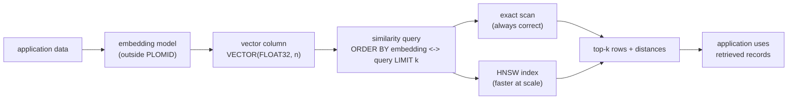

# Vector search overview

PLOMID stores dense embedding vectors as a native column type and searches them with SQL distance operators. You insert vectors as literals, rank rows with `ORDER BY ... LIMIT k`, and optionally accelerate large scans with an HNSW index. **Supported** in `v0.1.0` for dense vectors; sparse, binary, and multivector types parse but have narrower execution paths (see [Limitations](/v0.1.0/vector/limitations)).

## The workflow

1. Your application converts data (text, images) into embeddings with an external model. PLOMID does **not** generate embeddings.
2. You store each embedding in a `VECTOR` column alongside ordinary fields (`id`, `label`, metadata).
3. You query with a distance operator (`<->`, `<=>`, `<#>`, `<~>`, `<%>`) and `ORDER BY ... LIMIT k`.
4. Without an index, every query is an exact scan — always correct, slower as data grows.
5. With an HNSW index, large datasets trade a small amount of recall for much faster candidate retrieval.

## Status at a glance

| Capability | Status | Details |
| --- | --- | --- |
| Dense `VECTOR` columns (FLOAT32/16, BFLOAT16, INT8/UINT8/INT4) | **Supported** | [Vector types](/v0.1.0/vector/vector-types) |
| Distance operators `<->` `<=>` `<#>` `<~>` `<%>` | **Supported** | [Distance operators](/v0.1.0/vector/distance-operators) |
| Exact top-k similarity search | **Supported** | [Similarity search](/v0.1.0/vector/similarity-search) |
| HNSW approximate search | **Supported** | [HNSW](/v0.1.0/vector/hnsw) |
| Other dense index methods (`ivf_flat`, `ivf_sq`, `ivf_pq`, `diskann`, `flat`) | **Supported** (dense columns only; small scans may still run exact; `ivf_sq`/`ivf_pq` are global quantized scans without inverted lists in v0.1.0) | [Indexes](/v0.1.0/vector/indexes) |
| Metadata filtering (`WHERE` + vector ordering) | **Supported** (served by exact path) | [Filtering](/v0.1.0/vector/filtering) |
| Binary vectors (`VECTOR(BINARY, n)`) | **Limited** (DDL + string literals + Hamming/Jaccard; Hamming ANN needs an explicit `USING BINARY` index, Jaccard stays exact-only) | [Limitations](/v0.1.0/vector/limitations) |
| Sparse / multivector types | **Experimental** (DDL parses; no verified literal/insert path) | [Limitations](/v0.1.0/vector/limitations) |
| GPU acceleration | **Unsupported** (CPU only; GPU setting degrades to CPU) | [Performance](/v0.1.0/vector/performance) |
| `CREATE INDEX ... USING hnsw` inside an explicit transaction | **Unsupported** (use autocommit) | [Troubleshooting](/v0.1.0/vector/troubleshooting) |

## Where to go

- New to vectors? [Quickstart](/v0.1.0/vector/quickstart) takes you from empty database to similarity search in minutes.
- Know embeddings already? [Vector types](/v0.1.0/vector/vector-types) → [Distance operators](/v0.1.0/vector/distance-operators) → [Similarity search](/v0.1.0/vector/similarity-search).
- Scaling up? [HNSW](/v0.1.0/vector/hnsw) → [Exact vs approximate](/v0.1.0/vector/exact-vs-approximate) → [Performance](/v0.1.0/vector/performance).
- Building retrieval? [Application integration](/v0.1.0/vector/application-integration) → [Semantic retrieval guide](/v0.1.0/guides/semantic-retrieval).
